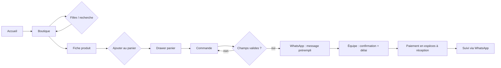
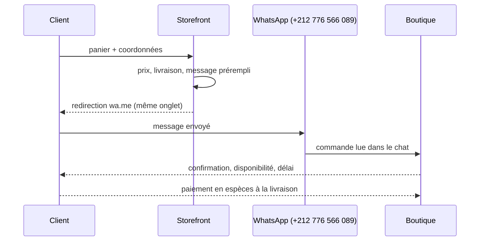
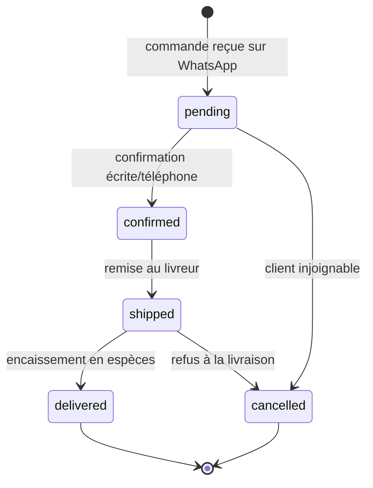
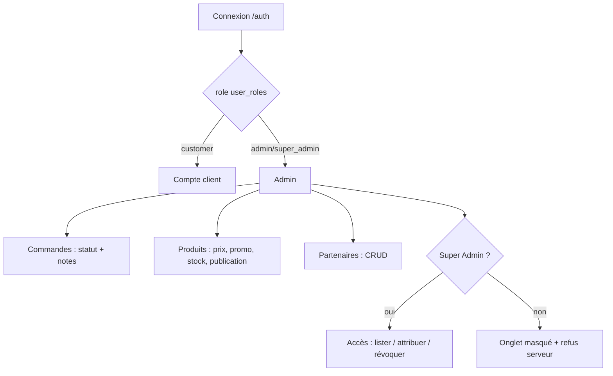

# Phase 2 — UX / UI Specification (UX Expert)

## 1. Information architecture

```
/                     Accueil (hero, réassurance, offre, catégories, best-sellers, sélection, partenaires, avis)
/shop                 Boutique — filtres catégorie/marque, recherche, tri, compteur
/product/$slug        Fiche produit — image, prix barré, stock, saveur, quantité, panier, nutrition, avis
/cart (drawer)        Panier — quantités, palier livraison gratuite, total
/checkout             Commande COD — nom, téléphone, e-mail, ville, adresse, remarques, récapitulatif
/track-order          Suivi — n° commande + téléphone (aucune donnée sans les deux)
/auth                 Connexion / inscription
/account 🔒           Compte client
/admin 🔒             Administration (commandes, produits, partenaires, accès Super Admin)
/partners             Salles partenaires
/about                Histoire, valeurs
/contact              Contact, WhatsApp, adresse
*                     404
```

## 2. Core user flows







## 3. Admin flow



## 4. Design tokens (as implemented in `src/styles.css`)

| Token | Value | Usage |
|---|---|---|
| Theme | dark-only (`<html class="dark">`) | entire store |
| `--background` | `oklch(0.13 0 0)` | page background |
| `--card` | `oklch(0.22 0.003 286)` | cards, drawers |
| `--primary` | `oklch(0.65 0.23 29)` (brand red) | CTAs, accents, badges |
| `--foreground` | `oklch(1 0 0)` | body text |
| `--muted-foreground` | `oklch(0.65 0.01 286)` | secondary text |
| `--gold` / `--success` / `--warning` | `0.89 0.18 95` / `0.76 0.2 150` / `0.77 0.17 65` | price highlight, stock OK, low stock |
| Radius | `0.75rem` base | cards `xl`, drawers, inputs |
| Display font | Space Grotesk 800 uppercase, `-.03em` | headlines |
| Body font | Inter 400–700 | copy |
| Mono font | JetBrains Mono 500 | prices, order numbers |
| Container | `max-w-7xl`, 1/1.5/2rem padding | layout |
| Section rhythm | 4rem mobile / 6rem desktop | vertical spacing |
| Motion | marquee 35–40 s, fade-up 0.7 s | reduced-motion respected |

## 5. Component inventory

**Layout & commerce:** `Layout.tsx` (AnnouncementBar, Header, Footer, CartDrawer, WhatsAppFab),
`ProductCard`, `PartnerMarquee`, `Countdown`.
**Primitives (shadcn/ui, 40+):** accordion, alert, badge, button, card, checkbox, dialog,
drawer, dropdown, form, input, label, select, sheet, skeleton, sonner, switch, table, tabs,
textarea, tooltip, etc. — new-york style, lucide icons.
**Admin:** `Editors.tsx` (EditorDialog, ProductFields, PartnerFields, OrderFields, SaveButton, Field).

## 6. Responsive behaviour

| Breakpoint | Behaviour |
|---|---|
| `< 768 px` | 2-column product grid, hamburger full-screen menu, drawer cart full-width, stacked checkout, horizontally scrollable admin tables |
| `≥ 768 px` | 4-column grid, horizontal nav, 2-column product page, two-column checkout |
| `≥ 1024 px` | 4 KPI cards, 3-column partner grid |

## 7. Accessibility (WCAG 2.2 AA) — design rules

- Every interactive icon has `aria-label`; product/cart images have `alt`.
- Form fields use `<Label htmlFor>`, `required`, `minLength`, `pattern` and native validation.
- Cart and editor dialogs are Radix Dialog/Sheet → focus trap + `Esc` + focus return.
- Checkout and tracking rely on native HTML validation and clearly labelled WhatsApp CTAs; the
  redirect is same-tab, so no pop-up blocker is involved.
- Admin tables scroll horizontally rather than clipping; tables have header cells.
- Motion is disabled under `prefers-reduced-motion`.
- Contrast: white on `oklch(0.13)` ≈ 18:1; primary red on white ≈ 5.2:1; muted text ≈ 7:1.

**Open a11y gaps (Dev-8):** no "skip to content" link, nav active state is colour-only
(`aria-current` missing), campaign marquee is decorative but not `aria-hidden`, no automated axe
run in CI. These are tracked in `06-qa.md`.
