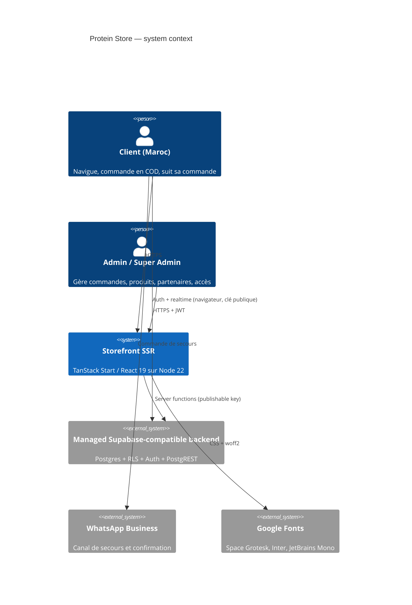

# Phase 2 — Architecture (Cloud & Dev Architect)

## 1. Context



## 2. Runtime topology (this host)

```mermaid
flowchart LR
  U[Internet] -->|443/80| C[Caddy 2.11<br/>TLS auto]
  C -->|127.0.0.1:5077| N[Node 22<br/>.output/server/index.mjs]
  N -->|HTTPS + apikey| S[(the managed backend<br/>Postgres/RLS/Auth)]
  B[Navigateur] -->|HTTPS| C
  B -.->|auth + REST direct| S
  N -. systemd: proteinstore.service .-> N
```

- **Isolation:** new `proteinstore.service` unit, port **5077**, hostname
  `proteinstore.46.225.2.52.sslip.io`. No shared unit is restarted; Caddy reload is graceful.
- **Build target:** `nitro: { preset: "node-server" }` (the template default, `cloudflare-module`,
  is useless here because there is no Cloudflare account).
- **TLS:** Caddy obtains a certificate for the sslip.io name; swapping to `proteinestore.ma`
  only changes the vhost and requires DNS A → `46.225.2.52`.

## 3. Stack decisions

| Layer | Choice | Justification |
|---|---|---|
| UI | React 19 + TypeScript 5.9, TanStack Router/Start 1.170 | Already in the repo; file-based routing, SSR, server functions, typed loaders. |
| Styling | Tailwind CSS 4 + shadcn/ui (new-york) + Radix | Fast dark brand UI, accessible primitives, 40+ components ready. |
| State | TanStack Query + React context (cart) | Server cache + local cart; no global store needed. |
| Validation | Zod 3 | Shared client/server schemas, already used by admin and orders. |
| Data | the managed backend (Postgres + RLS + PostgREST + Auth) | Live data, auth, policies and 58 products already there; rebuilding would be weeks and risk data loss. |
| Server runtime | Node 22 + Nitro `node-server` | No Docker on host, systemd-native, small memory footprint. |
| Reverse proxy | Caddy 2.11 | Already production-grade on the host, automatic TLS, HTTP/3. |
| Tests | Vitest 4 + Testing Library | Already configured; fast unit tests. |
| CI | GitHub Actions (proposed) | Install, unit tests, build on every push. |

**Rejected:** self-hosted Postgres (no Docker, RLS/auth rewrite), Cloudflare Workers (no account,
and the app needs Node-compatible SSR), Vercel (owner asked for this host), card gateways (COD-only
decision).

## 4. Folder structure

```
proteinstore/
├── src/
│   ├── routes/                 # file-based pages (+ _authenticated guard)
│   ├── components/
│   │   ├── site/               # Layout, ProductCard, Countdown, PartnerMarquee
│   │   ├── admin/Editors.tsx   # dialog forms
│   │   └── ui/                 # shadcn primitives
│   ├── lib/
│   │   ├── catalog.functions.ts  # public server functions
│   │   ├── orders.functions.ts   # COD create + tracking (rate-limited)
│   │   ├── admin.functions.ts    # RBAC server functions
│   │   ├── rate-limit.server.ts  # in-memory limiter (server only)
│   │   ├── pricing.ts            # pure pricing rules (unit-tested)
│   │   ├── cart.tsx              # localStorage cart
│   │   └── admin-rules.ts        # pure RBAC predicates (unit-tested)
│   ├── integrations/supabase/  # generated clients (do not hand-edit)
│   ├── test/                   # vitest suites
│   └── styles.css              # design tokens
├── deploy/                     # systemd unit + Caddy snippet
├── scripts/smoke.mjs           # read-only production smoke test
├── docs/                       # this delivery's documentation
├── drizzle/                    # reference schema/migrations (not used at runtime)
└── .output/                    # build artefact (node server)
```

## 5. Request flow (server function)

1. Browser calls `/__serverFn/...` with an optional Supabase JWT.
2. `attachSupabaseAuth` (client middleware) attaches `Authorization: Bearer <jwt>`.
3. `createCsrfMiddleware` rejects cross-site server-function calls.
4. zod `inputValidator` rejects malformed payloads.
5. Handler re-checks authorization (`requireSupabaseAuth` + `user_roles`) and re-computes prices.
6. Public read paths use the publishable key; checkout builds a WhatsApp message client-side and
   writes nothing to the database.

## 6. ADRs

| ID | Decision | Status |
|---|---|---|
| ADR-001 | Keep TanStack Start instead of rewriting to Next.js | Accepted — repo is source of truth |
| ADR-002 | Keep the managed backend as the data/auth layer | Accepted — live data, RLS, auth |
| ADR-003 | Build Node server via `nitro.preset = "node-server"` | Accepted |
| ADR-004 | COD only, no payment gateway in v1 | Accepted (BA) |
| ADR-005 | Service-role key server-only, loaded lazily, never in the client bundle | Accepted (Security) |
| ADR-006 | In-memory rate limiter for public writes | Accepted — single process; revisit at scale |
| ADR-007 | systemd + Caddy on isolated port 5077/hostname | Accepted (owner) |
| ADR-008 | Committed `.env` removed from the index; `.env.example` ships instead | Accepted (Security) |
| ADR-009 | Orders are handed off to WhatsApp; no server-side order writes | Accepted (owner) |

## 7. CI/CD skeleton

`.github/workflows/ci.yml` is included: Node 22, `npm ci --legacy-peer-deps`, unit tests,
production build. Deployment stays manual on this host (`deploy/` + runbook) because the owner
has not provided a deployment token or DNS automation.

## 8. Observability & cost

- **Logs:** `journalctl -u proteinstore`; Caddy access logs in `journalctl -u caddy`.
- **Uptime:** `scripts/smoke.mjs` can run from cron or an external monitor every 5 min.
- **Metrics:** no APM yet. Recommended next step: Sentry (`@sentry/react` + Node) and a
  `/healthz` route.
- **Cost:** only the existing VPS; the managed backend plan unchanged. No new managed service.
