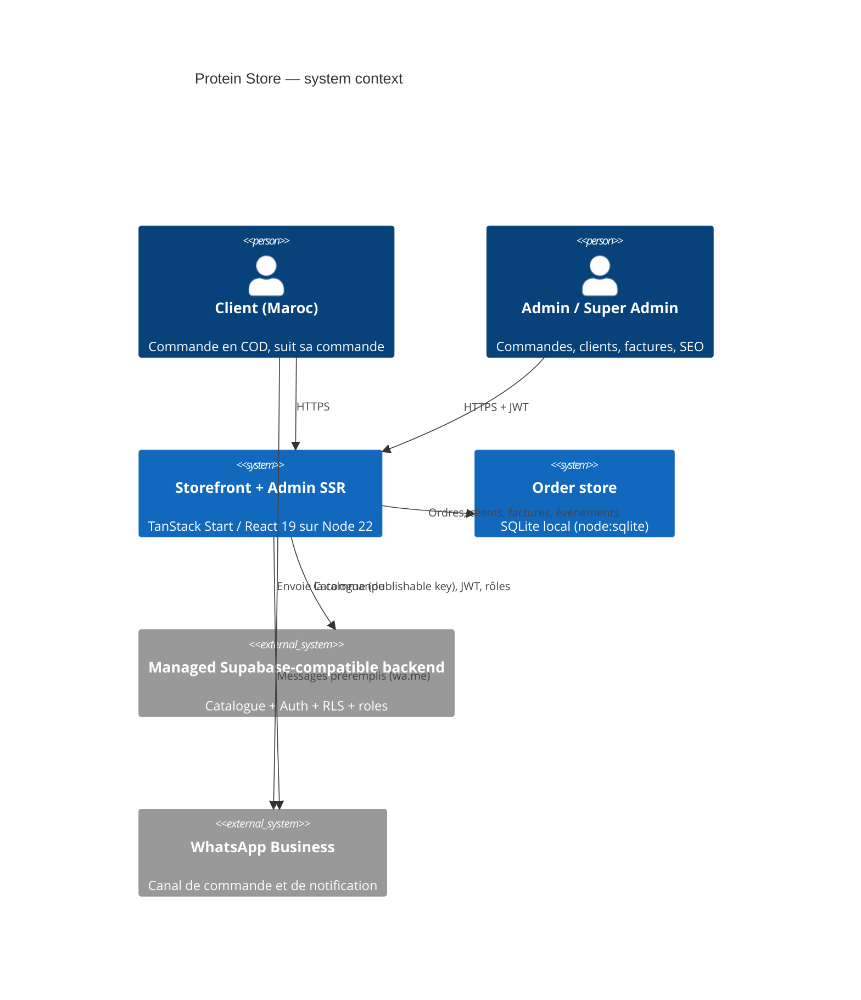
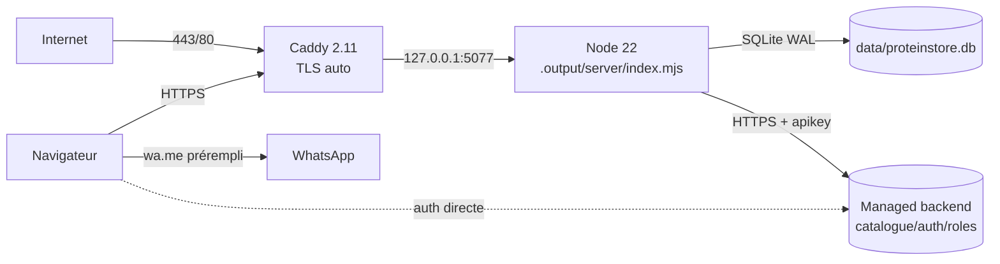
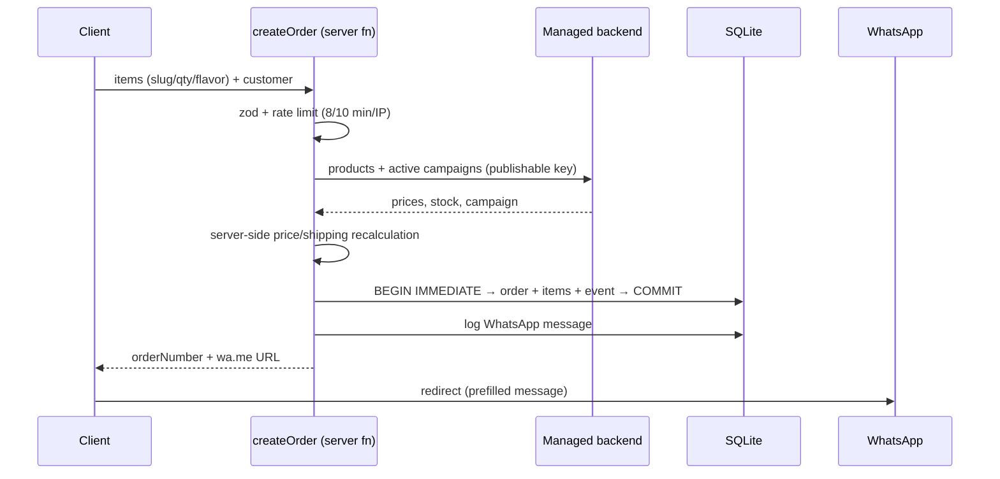

# Phase 2 — Architecture (Cloud & Dev Architect)

## 1. Context



## 2. Runtime topology (this host)



- **Isolation:** `proteinstore.service`, port **5077**, `ReadWritePaths=/root/Said/proteinstore/data`.
- **Build:** Nitro `node-server`; no Cloudflare.
- **TLS:** Caddy; target domain `proteinestore.pro` prepared in `deploy/Caddyfile.snippet`.

## 3. Stack decisions

| Layer | Choice | Justification |
|---|---|---|
| UI | React 19 + TS 5.9, TanStack Router/Start 1.170 | SSR, typed loaders, server functions, file routing. |
| Styling | Tailwind 4 + shadcn/ui + Radix | Fast dark brand UI, accessible primitives. |
| State | TanStack Query + cart context | Server cache + local cart. |
| Validation | Zod | Shared server-side schemas for orders and admin writes. |
| Orders | **Node 22 `node:sqlite`** | No new service, no Docker, no service-role key; ACID transactions. |
| Catalogue/auth | Managed Supabase-compatible Postgres + RLS | 58 products, auth and roles already live; no migration. |
| Runtime | Node 22 + Nitro `node-server` | systemd-native, ~50 MB RSS. |
| Proxy | Caddy 2.11 | TLS, HTTP/3, headers. |
| Messaging | WhatsApp deep links (`wa.me`) | No Business API onboarding; every action produces a prefilled message. |

**Rejected:** Supabase order writes without a service key (impossible under RLS); permissive `orders`
INSERT policy (unsafe); self-hosted Postgres (no Docker, auth rewrite).

## 4. Folder structure

```
proteinstore/
├── src/
│   ├── routes/
│   │   ├── _authenticated/admin.tsx        # dashboard: overview/orders/customers/invoices/SEO
│   │   ├── _authenticated/admin.store.tsx  # catalogue, partners, staff
│   │   ├── checkout.tsx                    # form → createOrder → WhatsApp redirect
│   │   └── track-order.tsx                 # real tracking timeline
│   ├── components/admin/                   # Orders/Customers/Invoices/SEO panels, invoice, WhatsApp modal
│   ├── lib/
│   │   ├── order-store.server.ts           # SQLite schema + repository (orders/items/events/invoices)
│   │   ├── order-types.ts                  # shared types/enums
│   │   ├── orders.functions.ts             # public create + tracking (rate-limited)
│   │   ├── store.functions.ts              # admin APIs (orders/customers/invoices/stats)
│   │   ├── seo.functions.ts                # SEO audit (admin)
│   │   ├── seo.ts                          # scoring + JSON-LD
│   │   ├── whatsapp.ts                     # message builders (order/status/invoice/payment)
│   │   ├── phone.ts                        # Moroccan phone normalization
│   │   ├── admin-guard.server.ts           # role check for admin server functions
│   │   └── rate-limit.ts                   # in-memory public rate limits
│   └── test/                               # 40 unit tests
├── data/                                   # SQLite database (git-ignored, writable by the unit)
├── deploy/                                 # systemd, Caddy, deploy script
├── scripts/                                # smoke, sitemap, order backup
└── docs/
```

## 5. Order write path



The order is stored **before** the redirect, so tracking, invoices and admin actions work even if the
customer never sends the message. Stock is checked but not decremented: the shop confirms availability in
the chat.

## 6. Admin request path

1. `_authenticated` guard ensures a Supabase session.
2. Client calls admin server functions; `attachSupabaseAuth` adds the JWT.
3. `requireSupabaseAuth` verifies the token; `requireStoreAdmin` reloads `user_roles` per call.
4. Handler reads/writes SQLite through prepared statements (no raw SQL interpolation).
5. Mutations return `{ data, whatsapp: { phone, message, url } }`; the UI opens the message and the message
   is logged in `whatsapp_messages` + `order_events`.

## 7. ADRs

| ID | Decision | Status |
|---|---|---|
| ADR-001 | Keep TanStack Start | Accepted |
| ADR-002 | Keep the managed data/auth layer for catalogue/auth | Accepted |
| ADR-003 | Nitro `node-server` build | Accepted |
| ADR-004 | COD only | Accepted |
| ADR-005 | No public `orders` INSERT in the managed backend | Accepted |
| ADR-006 | In-memory rate limiter for public writes | Accepted (single process) |
| ADR-007 | systemd + Caddy on isolated 5077 | Accepted |
| ADR-008 | `.env` untracked, `.env.example` ships | Accepted |
| ADR-009 | **Local SQLite order store** (`node:sqlite`) for orders/customers/invoices | Accepted — no service key, ACID, single host |
| ADR-010 | Every customer-facing admin action produces a WhatsApp message; admin opens it | Accepted — no Business API required |
| ADR-011 | Public tracking reads the same event log the admin writes | Accepted |

## 8. CI/CD

`.github/workflows/ci.yml`: `npm ci --legacy-peer-deps`, `tsc --noEmit`, `npm test`, `npm run build`
(includes sitemap), non-blocking lint/audit. Deployment stays manual (`deploy/deploy.sh`) on this host.

## 9. Observability & cost

- Logs: `journalctl -u proteinstore` (server errors include `[orders]`, `[ui]` tags).
- Smoke: `scripts/smoke.mjs` (21 checks) for cron/external monitor.
- Backups: `scripts/backup-orders.mjs` (14 daily snapshots).
- No APM yet; Sentry is the recommended next step.
- Cost: existing VPS + managed backend plan; SQLite adds no service.
