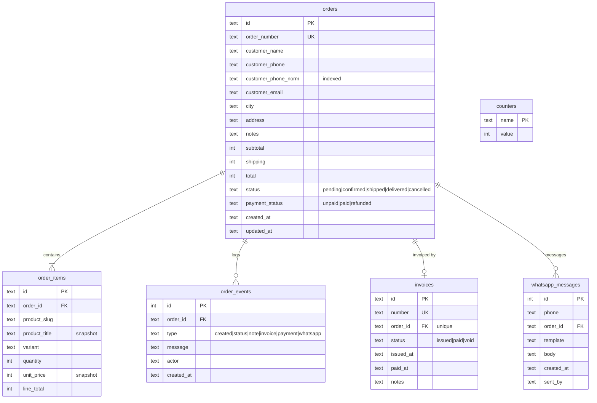

# Phase 2 — Data Model (Database Expert)

Two stores back the application:

1. **Managed Supabase-compatible Postgres** — catalogue, auth, roles (10 tables, RLS).
2. **Local SQLite** (`data/proteinstore.db`, `node:sqlite`) — orders, order items, events, invoices and the
   WhatsApp log. This is the order system of record and needs no service-role key.

Sources: PostgREST OpenAPI + `src/integrations/supabase/types.ts`, `drizzle/migrations/0000_store_schema_and_seed.sql`
(reference DDL), and `src/lib/order-store.server.ts` (local schema).

## 1. ERD


`auth.users` is managed by Supabase and is not exposed through PostgREST.

## 2. Design notes

- **Money is integer MAD.** No floats, no cents: the Moroccan retail convention here is whole
  dirhams. `unitPrice()` rounds campaign percentages to the nearest dirham.
- **Historical snapshots.** `order_items.product_title` and `price_at_purchase` are copied at
  purchase time so later catalogue edits never rewrite history.
- **Address as JSONB.** `shipping_address` keeps `{address, city, postal}` without a join; the
  columns are small and always read together.
- **Campaign targeting arrays.** `category_ids` / `product_ids` are `uuid[]`; fine for < 100
  campaigns. At scale, normalise into `campaign_targets`.
- **Enums.** `app_role` (`customer|admin|super_admin`) and `order_status`
  (`pending|confirmed|shipped|delivered|cancelled`) are Postgres enums — invalid states are
  rejected by the database, not only by the UI.

## 3. Indexes & constraints

| Object | Status |
|---|---|
| `products.slug` UNIQUE, `categories.slug` UNIQUE, `orders.order_number` UNIQUE, `subscribers.email` UNIQUE | ✅ present |
| `order_items.order_id` FK ON DELETE CASCADE | ✅ present |
| `products.stock_quantity >= 0`, `price >= 0`, `rating 1..5` | ✅ CHECK constraints |
| Index on `orders(status, created_at)` for admin queues | ⚠️ missing — add when orders grow |
| Index on `products(category_id)` and GIN on `products(flavors)` | ⚠️ missing; catalogue is 58 rows so no impact today |
| Index on `campaigns(is_active, start_date, end_date)` | ⚠️ missing; 1 campaign today |

Recommended migration (not applied — needs DB owner approval):

```sql
CREATE INDEX IF NOT EXISTS orders_status_created_idx ON public.orders (status, created_at DESC);
CREATE INDEX IF NOT EXISTS products_category_idx ON public.products (category_id);
CREATE INDEX IF NOT EXISTS campaigns_active_window_idx ON public.campaigns (is_active, start_date, end_date);
```

## 4. Row-Level Security (RLS) — as implemented

| Table | anon | authenticated | admin / super_admin |
|---|---|---|---|
| `products` | SELECT published | SELECT published | ALL |
| `categories` | SELECT | SELECT | ALL |
| `partners` | SELECT active | SELECT active | ALL |
| `campaigns` | SELECT active | SELECT active | ALL |
| `reviews` | SELECT approved | SELECT approved, INSERT own unverified | ALL |
| `orders` | **none** | SELECT own, UPDATE none | SELECT/UPDATE/DELETE (admin, super_admin) |
| `order_items` | none | SELECT own order | SELECT all |
| `profiles` | none | SELECT/UPDATE own | SELECT all |
| `user_roles` | none | SELECT own | SELECT all; staff writes via service role |
| `subscribers` | INSERT only | INSERT only | SELECT |

**Consequence:** the managed `orders` table is never written by the app. Checkout writes to the local
SQLite store and then hands the order to WhatsApp; the managed table stays historical/unused. There is no
public INSERT policy and none should be added (see `AGENTS.md`).

## 5. Concurrency & integrity (local SQLite)

- **Transactions:** `createOrder` runs `BEGIN IMMEDIATE` → order + items + `created` event → `COMMIT`;
  any failure rolls back. Node's SQLite driver serialises writers in one process.
- **Numbering:** `counters` is updated with `INSERT ... ON CONFLICT DO UPDATE ... RETURNING`, so order and
  invoice numbers are gap-free per sequence (`PS-YYYY-NNNNN`, `FAC-YYYY-NNNNN`).
- **Stock:** checked against the live catalogue before insert, but **not decremented** — WhatsApp orders are
  confirmed by the shop, which owns stock in the chat. No oversell risk because no online reservation exists.
- **Immutability:** item title, variant and unit price are snapshotted in `order_items`; later catalogue edits
  never rewrite history.
- **Events:** status changes, notes, invoice issues, payments and WhatsApp sends append to `order_events`
  (append-only; no update/delete path in the app).
- **Backups:** SQLite WAL is backed up with the built-in `backup()` API (`scripts/backup-orders.mjs`), which
  is safe while the service runs.

## 6. Seed / reference data

Live backend: **58 products, 8 categories, 9 partners, 1 campaign, 5 reviews** (counts read on
19/10/2026). `drizzle/migrations/0000_store_schema_and_seed.sql` contains a smaller reference seed
(21 products, 6 categories, 9 gyms, 4 campaigns, 30 reviews, 10 orders) that documents the intended
shape; it is **not** applied to the live database automatically.

## 7. Backup & retention

- **Local orders:** `node scripts/backup-orders.mjs` writes a consistent snapshot to `data/backups/` and keeps
  the last 14. Run it daily (cron) and before every deploy that changes the schema.
- **Managed backend:** the provider manages Postgres backups; confirm the retention window in its dashboard.
- **Retention:** financial records (orders/invoices) are kept 13 months minimum. Personal data is needed to
  deliver the order; the admin can annotate/anonymise on request (no automated deletion yet).

## 8. Local order store — ERD



Indexes: `orders(created_at DESC)`, `orders(customer_phone_norm)`, `orders(status, created_at DESC)`,
`order_items(order_id)`, `order_events(order_id, id)`, `whatsapp_messages(order_id, id)`.

Accessed only by server modules (`order-store.server.ts`); the DB file is never exposed by Caddy.
