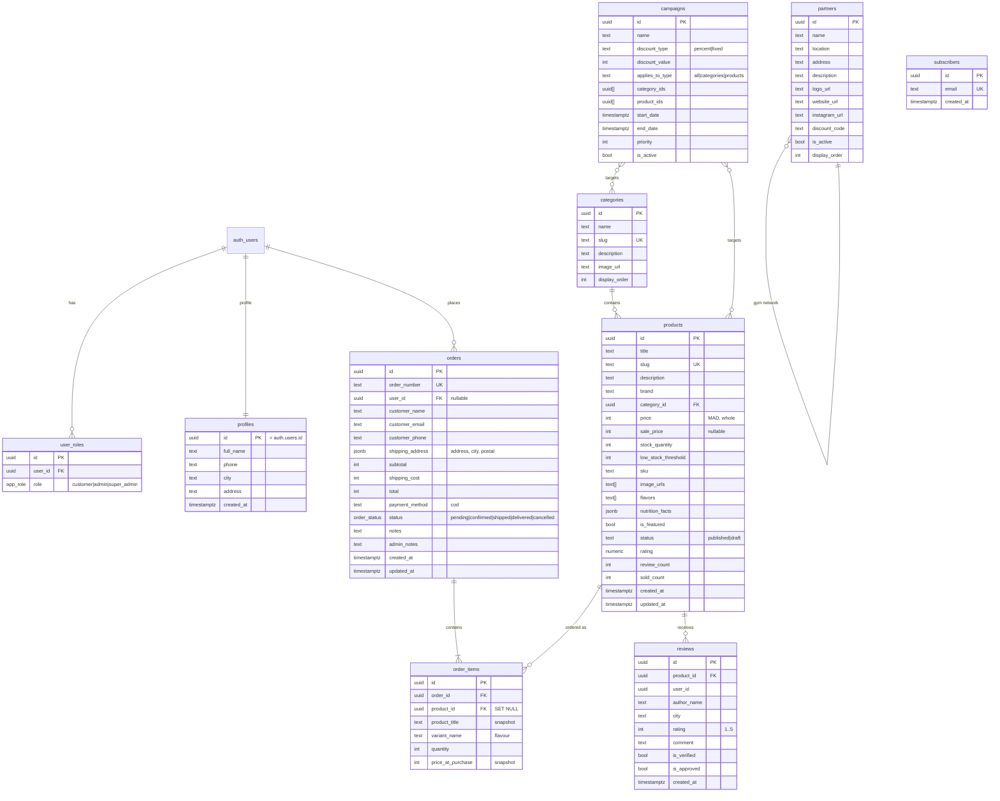

# Phase 2 — Data Model (Database Expert)

Source: live Lovable Cloud Postgres (PostgREST OpenAPI + `src/integrations/supabase/types.ts`)
and `drizzle/migrations/0000_store_schema_and_seed.sql` (reference DDL). **10 tables.**

## 1. ERD



`auth.users` is managed by Supabase and is not exposed through PostgREST.

## 2. Design notes

- **Money is integer MAD.** No floats, no cents: the Moroccan retail convention here is whole
  dirhams. `unitPrice()` rounds campaign percentages to the nearest dirham.
- **Historical snapshots.** `order_items.product_title` and `price_at_purchase` are copied at
  purchase time so later catalogue edits never rewrite history.
- **Address as JSONB.** `shipping_address` keeps `{address, city, postal}` without a join; the
  columns are small and always read together.
- **Campaign targeting arrays.** `category_ids` / `product_ids` are `uuid[]`; fine for < 100
  campaigns. At scale, normalise into `campaign_targets`.
- **Enums.** `app_role` (`customer|admin|super_admin`) and `order_status`
  (`pending|confirmed|shipped|delivered|cancelled`) are Postgres enums — invalid states are
  rejected by the database, not only by the UI.

## 3. Indexes & constraints

| Object | Status |
|---|---|
| `products.slug` UNIQUE, `categories.slug` UNIQUE, `orders.order_number` UNIQUE, `subscribers.email` UNIQUE | ✅ present |
| `order_items.order_id` FK ON DELETE CASCADE | ✅ present |
| `products.stock_quantity >= 0`, `price >= 0`, `rating 1..5` | ✅ CHECK constraints |
| Index on `orders(status, created_at)` for admin queues | ⚠️ missing — add when orders grow |
| Index on `products(category_id)` and GIN on `products(flavors)` | ⚠️ missing; catalogue is 58 rows so no impact today |
| Index on `campaigns(is_active, start_date, end_date)` | ⚠️ missing; 1 campaign today |

Recommended migration (not applied — needs DB owner approval):

```sql
CREATE INDEX IF NOT EXISTS orders_status_created_idx ON public.orders (status, created_at DESC);
CREATE INDEX IF NOT EXISTS products_category_idx ON public.products (category_id);
CREATE INDEX IF NOT EXISTS campaigns_active_window_idx ON public.campaigns (is_active, start_date, end_date);
```

## 4. Row-Level Security (RLS) — as implemented

| Table | anon | authenticated | admin / super_admin |
|---|---|---|---|
| `products` | SELECT published | SELECT published | ALL |
| `categories` | SELECT | SELECT | ALL |
| `partners` | SELECT active | SELECT active | ALL |
| `campaigns` | SELECT active | SELECT active | ALL |
| `reviews` | SELECT approved | SELECT approved, INSERT own unverified | ALL |
| `orders` | **none** | SELECT own, UPDATE none | SELECT/UPDATE/DELETE (admin, super_admin) |
| `order_items` | none | SELECT own order | SELECT all |
| `profiles` | none | SELECT/UPDATE own | SELECT all |
| `user_roles` | none | SELECT own | SELECT all; staff writes via service role |
| `subscribers` | INSERT only | INSERT only | SELECT |

**Consequence:** creating an order is a privileged server-side write. `src/lib/orders.functions.ts`
uses the service-role client, validates every input, recomputes prices and shipping, and never
trusts the client. This is why `SUPABASE_SERVICE_ROLE_KEY` is mandatory for COD.

## 5. Concurrency & integrity

- **Overselling:** fixed. Stock is decremented with an optimistic predicate
  (`UPDATE ... WHERE id = ? AND stock_quantity = <value read>`). Zero rows matched → the order and
  its items are deleted and the customer gets `STOCK_RACE`. This is not a serializable transaction,
  but it removes the common double-sell.
- **Order + items atomicity:** PostgREST has no multi-statement transaction here; the code deletes
  the order (cascade) if item insertion or stock decrement fails. Residual risk: a network failure
  between insert and rollback can leave a `pending` order with missing items. Mitigation: a
  nightly reconciliation query (see runbook).
- **Idempotency:** not implemented. A double-click creates two orders. Client disables the button
  while `busy`; a server-side idempotency key is a next-step improvement.

## 6. Seed / reference data

Live backend: **58 products, 8 categories, 9 partners, 1 campaign, 5 reviews** (counts read on
19/10/2026). `drizzle/migrations/0000_store_schema_and_seed.sql` contains a smaller reference seed
(21 products, 6 categories, 9 gyms, 4 campaigns, 30 reviews, 10 orders) that documents the intended
shape; it is **not** applied to the live database automatically.

## 7. Backup & retention

- Lovable Cloud manages Postgres backups on its plan; **the owner must confirm the retention
  window** in the Lovable dashboard. This host keeps no database copy.
- Recommended: weekly logical export (`pg_dump --data-only`) stored off-host for 30 days.
- Personal data (name, phone, email, address) is needed only to fulfil the order. Recommended
  retention: 13 months for delivered orders, then anonymise name/phone/address while keeping the
  financial line items. Not implemented — see security doc.
